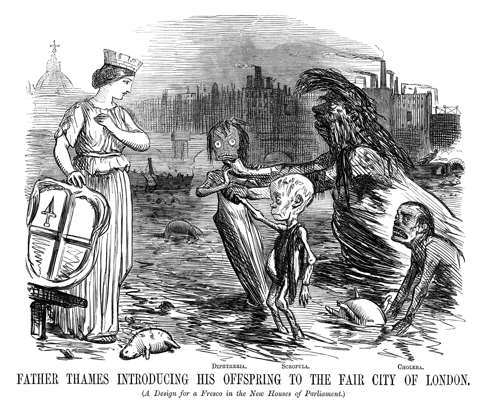

```{r setup, include=FALSE,warning=FALSE,message=FALSE}
options(htmltools.dir.version = FALSE)
knitr::opts_chunk$set(
  message = FALSE,
  warning = FALSE,
  dev = "svg",
  cache = TRUE,
  autodep = TRUE,
  fig.align = "center"
  #fig.width = 11,
  #fig.height = 5
)

# define vars
om = par("mar")
lowtop = c(om[1],om[2],0.1,om[4])
library(magrittr)
library(ggplot2)
library(broom)
library(estimatr)
library(modelsummary)
gm = modelsummary::gof_map
gm$omit <- TRUE
gm$omit[gm$clean == "R2"] <- FALSE
gm$omit[gm$clean == "Num.Obs."] <- FALSE
gom = "p.value.|se_type|statistic.end|statistic.overid|statistic.weakinst"
```

```{css, echo=FALSE}
.left-thin { width: 28%; float: left; }
.right-wide { width: 68%; float: right; }
.left-wide { width: 68%; float: left; }
.right-thin { width: 28%; float: right; }
```

## Today

* We introduce *instrumental variables* (IV), a third way to get at causal effects with observational data (after RDD and DiD). *Bonus lecture: not formally assessed.*

* To motivate IV, we look back to London in 1850 and learn about John Snow.

* We then define the IV estimator formally, apply it to returns to schooling (Angrist and Krueger, 1991), and discuss inference and weak instruments.


---

# Setting the Scene

.pull-left[

* In chapters [7](https://scpoecon.github.io/ScPoEconometrics/causality.html), [8](https://scpoecon.github.io/ScPoEconometrics/STAR.html) and [9](https://scpoecon.github.io/ScPoEconometrics/RDD.html) of the book (and the intro course) we talk about the merits of _experimental methods_.

* Randomized Control Trials (RCTs) or _quasi-experimental_ (as good as random) settings, like RDD and DiD, allow us to estimate **causal** effects.

* In particular the [RCT](https://scpoecon.github.io/ScPoEconometrics/causality.html#rct) should be familiar to you.

]


.pull-right[

* If people have some sort of control about getting treatment, there will be *selection*.

* RCTs can break the self-selection of people into treatment by assigning randomly.

* So with experimental data, we have a good solution.

* What about non-experimental data?
]

---

# Non-Experimental Data

.pull-left[

* We talked about **omitted variable bias**.

* What if there is correlation between a variable in the error term $u$, $x_2$ say, and our explanatory variable $x_1$?

* We will obtain biased estimates because we cannot separate out what  is what: effect of $x_1$, or of $x_2$?

* Remember that this can be so severe that we don't even get the correct sign of an effect.
]

.pull-right[

```{r dag1,fig.height = 6,echo = FALSE}
library(ggdag)
library(dplyr)
dag = dagify(y ~ x1,
            y ~ x2,
            y ~ x3,
            x1 ~ x2,
            x3 ~ x2,
       coords = list(x = c("x2" = 0,"x1" = 1,"x3" = 1.0,"y" = 2),
                     y = c("x2" = 0,"x1" = 0.5,"x3" = -0.5,"y" = 0)))
p2 = dag %>%
  tidy_dagitty() %>%
      mutate(linetype = if_else(name =="x2", "dashed","solid")) %>% 
    ggplot(aes(x = x, y = y, xend = xend, yend = yend)) + 
    geom_dag_point() + 
      geom_dag_text(col = "white") +
    geom_dag_edges(aes(edge_linetype = linetype), show.legend = FALSE) + theme_dag()
p2
```
]


.center[**IV** provides a solution to OVB.]

---
background-image: url(../img/Kensington_slums_large.jpg)
background-size: cover
class: middle

# <span style="color: #FFFFFF;">Welcome to London in 1850</span>

## <span style="color: #FFFFFF;">(Slum in Kensington)</span>

---

# John Snow's (Non) Experiment: Cholera Hits the Town

.pull-left[

* John Snow was a physician in London around 1850, when Cholera erupted several times in the City.

* There was a dispute at the time about how the disease is transmitted: via air or via water?

]

.pull-right[
```{r, fig.width=6,echo = FALSE}

```
]

---
background-image: url(../img/slum.jpg)
background-size: cover

.center[
<br>
<br>
<br>

## <span style="color: #FFFFFF;">In 1850:</span>


### <span style="color: #FFFFFF;">Unknown that germs can cause disease.</span>

### <span style="color: #FFFFFF;">Microscopes exist, but work at rather poor resolution.</span>

### <span style="color: #FFFFFF;">Most human pathogens are not visible to the naked eye.</span>

### <span style="color: #FFFFFF;">The so-called *infection theory* (i.e. infection via *germs*) had some supporters,</span>

### <span style="color: #FFFFFF;">but the dominant idea was that disease, in general, results from [*miasmas*](https://en.wikipedia.org/wiki/Miasma_theory)</span>

]

---
background-image: url(https://media.giphy.com/media/3s4jGZP9UapxROVVN9/giphy.gif)
background-size: 800px

# Let's Go Watch a Movie

<br>
<br>
<br>
<br>
<br>
<br>
<br>
<br>
<br>
<br>
<br>
<br>
<br>
<br>
<br>
<br>

.center[May the force be with you. (click [here!](https://youtu.be/lNjrAXGRda4?si=Oj-MONvr9Exp-2xo))]


---

# Snow's Detective Work

.pull-left[

* Snow collected a lot of data.

* He first mapped the location of dead during the 1854 outbreak.

* This was the notorious *Broadstreet Pump Outbreak*

]

.pull-right[
```{r snow-map,echo = FALSE}

```
]

---

# The `cholera` package

.pull-left[
The `cholera` package has some interesting features. For example, the walking path of case number 15 in Snow's data:

```{r,echo = FALSE,fig.height = 5}
plot(cholera::walkingPath(15))
```
]

.pull-right[
...or Voronoi polygons for pump neighborhoods:
```{r,echo = FALSE,fig.height = 5}
# compute vertices of Voronoi tiles
vertices <- cholera::voronoiPolygons(sites = cholera::pumps, rw.data = cholera::roads)

# define colors
snow.colors <- grDevices::adjustcolor(cholera::snowColors(), alpha.f = 1/3)

# plot map and color coded tiles
cholera::snowMap(add.cases = FALSE)
invisible(lapply(seq_along(vertices), function(i) {
  polygon(vertices[[i]], col = snow.colors[[i]])
}))
```
]

---

# Removal of the Broad Street Pump?

.pull-left[
* Snow identified the Broad Street Pump as culprit.

* He pleaded to have its handle removed, but he was skeptical this was the reason the epidemic ended.

]

.pull-right[
```{r,echo = FALSE}
plot(cholera::timeSeries())
```
]

---

# Mapping London's Water Supply


* Water supply came from the River Thames

* Different supply companies had different intake points

* Southwark and Vauxhall water companies took in water beneath a major sewage discharge.

* Lambeth water did not.


---

# Snow's conclusion

* Snow collected the following data (cholera deaths by water supplier): 

```{r,echo = FALSE}
st9 <- data.frame(area = c("Southwark and Vauxhall","Lambeth","Rest of London"),numhouses = c(40046,26107,256423), 
                  deaths = c(1263,98,1422),
                   deaths_per_10k_houses = c(315,37,59))
knitr::kable(st9)
```

* And concluded

>that if Southwark and Vauxhall water companies had moved their water intakes upstream to where Lambeth water was taking in their supply, roughly 1,000 lives could have been saved. 

* For proponents of the miasma theory, this was still not evidence enough, because there were also many factors that led to poor air quality in those areas.

---

layout: false
class: separator, middle

# We Need A Model, because...

## *It takes a model to beat a model*, which is attributed to Thomas L Sargent.

---

# Snow's Model of Cholera Transmission


* Suppose that $c_i$ takes the value 1 if individual $i$ dies of cholera, 0 else.

* Let $w_i = 1$ mean that $i$'s water supply is impure and $w_i = 0$ vice versa. Water purity is assessed with a technology that cannot detect small microbes.

* Collect in $u_i$ all unobservable factors that impact $i$'s likelihood of dying from the disease: whether $i$ is poor, where exactly they reside, whether there is bad air quality in $i$'s surrounding, and other individual characteristics which impact the outcome (like genetic setup of $i$).


We can write:

$$
c_i = \alpha + \delta w_i + u_i 
$$

---

# Is the Simple Thing Good Enough?

.pull-left[

* John Snow could have used his data and assess the correlation between drinking pure water and cholera incidence.

* Measure $Cor(c_i,w_i)$

* Suppose $Cor(c_i,w_i) \approx 0.5$. Does that prove the infection theory?
]


.pull-right[
Not quite. Angus Deaton says:

> The people who drank impure water were also more likely to be poor, and to live in an environment contaminated in many ways, not least by the ‘poison miasmas’ that were then thought to be the cause of cholera.

]

---

# The Simple Thing


* It does not make sense to compare someone who drinks pure water with someone with impure water because *all else is not equal*: pure water is correlated with being poor, living in bad area, bad air quality and so on - all factors that we encounter in $u_i$. 

* This violates the crucial orthogonality assumption for valid OLS estimates, $E[u_i | w_i]=0$ in this context. 

* Another way to say this, is that $Cov(w_i, u_i) \neq 0$, implying that $w_i$ is *endogenous*. 

* There are factors in $u_i$ that affect both $w_i$ and $c_i$

---

# Snow's Model and Some Algebra

Remember our simple model:
$$c_i = \alpha + \delta w_i + u_i$$
Now let's condition on both values of $w$:
\begin{align}
E[c_i | w_i = 1] &= \alpha + \delta + E[u_i | w_i = 1] \\
E[c_i | w_i = 0] &= \alpha + \phantom{\delta} + E[u_i | w_i = 0]
\end{align}


Now subtract one line from the other:

\begin{equation}
E[c_i | w_i = 1] - E[c_i | w_i = 0] = \delta + \left\{ E[u_i | w_i = 1] - E[u_i | w_i = 0]\right\}
\end{equation}

* The last term $\left\{ E[u_i | w_i = 1] - E[u_i | w_i = 0]\right\}$ is not equal to zero (by what Deaton said!)

* A regression estimate for $\delta$ would be biased by that quantity.

---


layout: false
class: separator, middle

# The IV Estimator

---

# John Snow Says

> [...] the mixing of the supply is of the most intimate kind. The pipes of each Company go down all the streets, and into nearly all the courts and alleys. [...] The experiment, too, is on the grandest scale. No fewer than three hundred thousand people of both sexes, of every age and occupation, and of every rank and station, from gentlefolks down to the very poor, were divided into two groups without their choice, and in most cases, without their knowledge; one group supplied with water containing the sewage of London, and amongst it, whatever might have come from the cholera patients, the other group having water quite free from such impurity.

---
background-image: url("../img/snow-supply.jpg")
background-size: cover

# London Water Supply

---

# Proposing an IV

* Snow is proposing an **instrumental variable** $z_i$, the *identity of the water supplying company* to household $i$:

More formally, let's define the instrument as follows:

\begin{align*}
z_i &=  \begin{cases}
                    1 & \text{if water supplied by Lambeth} \\
                    0 & \text{if water supplied by Southwark or Vauxhall.} \\
                 \end{cases} \\
\end{align*}

* $z_i$ is highly correlated with the water purity $w_i$. 

* However, it seems to be uncorrelated with all the other factors in $u_i$, which worried us before: Water supply was decided years before, and now houses on the same street have different suppliers!

---
background-image: url(../img/IV-dag.png)
background-position: 60% 50%

# Simple IV in a DAG

* $u$ affects both outcome and explanatory variable

```{r IV-dag,warning = FALSE,eval = FALSE,message = FALSE,echo = FALSE,fig.height = 5}
library(ggdag)
library(dplyr)
coords <- list(
    x = c(z = 1, w = 3, u = 4, c = 5),
    y = c(z = 0, w = 0, u = 0.5, c = 0)
    )

dag <- dagify(c ~ w + u,
              w ~ z + u, coords = coords)

dag %>% 
  tidy_dagitty() %>% 
  mutate(linetype = ifelse(name == "u", "dashed", "solid")) %>% 
  ggplot(aes(x = x, y = y, xend = xend, yend = yend)) + 
  geom_dag_point() + 
  geom_dag_text() + 
  geom_dag_edges(aes(edge_linetype = linetype), show.legend = FALSE) + 
  theme_void()

```

---

# Defining Snow's IV Formally

Here are the conditions for a valid instrument:

1. **Relevance** or **First Stage**: Water purity is indeed a function of supplier identity. We want that $$E[w_i | z_i = 1] \neq E[w_i | z_i = 0]$$ i.e. the average water purity differs across suppliers. We can *verify* this condition with observational data.

2. **Independence**: Whether a household has $z_i = 1$ or $z_i = 0$ is unrelated to $u$, hence *as good as random*. Whether we condition $u$ on certain values of $z$ does not change the result: $$E[u_i | z_i = 1] = E[u_i | z_i = 0].$$

3. **Exclusion restriction**: the instrument should affect the outcome $c$ *only* through the specified channel (i.e. via water purity $w$), and nothing else.

---

# Defining the IV Estimator

We are now ready to define a simple IV estimator. Like before, let's condition on the values of $z$:

\begin{align}
E[c_i | z_i = 1] &= \alpha + \delta E[w_i | z_i = 1] + E[u_i | z_i = 1] \\
E[c_i | z_i = 0] &= \alpha + \delta E[w_i | z_i = 0] + E[u_i | z_i = 0]
\end{align}

which upon differencing both lines gives 

\begin{align}
E[c_i | z_i = 1] - E[c_i | z_i = 0] &= \delta  \left\{ E[w_i | z_i = 1] - E[w_i | z_i = 0]\right\} \\
&+ \underbrace{\left\{ E[u_i | z_i = 1] - E[u_i | z_i = 0] \right\}}_{=0 \text{ by Independence and Exclusion}}
\end{align}


* Finally, if the IV is *relevant*, i.e. $E[w_i | z_i = 1] - E[w_i | z_i = 0] \neq 0$:

\begin{equation}
\delta = \frac{E[c_i | z_i = 1] - E[c_i | z_i = 0]}{E[w_i | z_i = 1] - E[w_i | z_i = 0]} (\#eq:IV)
\end{equation}


---

# Special Case: Wald Estimator

We write $x \mapsto y$ to say that $x$ is a sample estimate of $y$:

1. $\overline{c}_1 \mapsto E[c_i | z_i = 1]$: the proportion of households supplied by Lambeth with cholera.
1. $\overline{w}_1 \mapsto E[w_i | z_i = 1]$: the proportion of households supplied by Lambeth with bad water.
1. $\overline{c}_0 \mapsto E[c_i | z_i = 0]$: the proportion of households not supplied by Lambeth with cholera.
1. $\overline{w}_0 \mapsto E[w_i | z_i = 0]$: the proportion of households not supplied by Lambeth with bad water.

The estimator would then be

\begin{equation}
\hat{\delta} = \frac{\overline{c}_1 - \overline{c}_0}{\overline{w}_1 - \overline{w}_0} 
\end{equation}

In this special case where all involved variables $c,w,z$ are binary, the estimator is called the *Wald estimator*.

---

# Applications

* We now look at more IV applications.

* We introduce an extension called *Two Stage Least Squares*.

* We will use `R` to compute the estimates.

* Finally we'll talk about *weak* instruments.

---

layout: false
class: separator, middle

# Prologue

## One cool `R` package a day, keeps the doctor away...

---
layout: false

# [`Rayshader`](https://www.rayshader.com)

* Can *raytrace* all kinds of elevation data.
* Can *also* make most `ggplot`s come to 3D-life!

<video width="90%" height="40%" controls id="my_video">
    <source src="https://www.tylermw.com/wp-content/uploads/2019/05/deathappended2.mp4" type="video/mp4">
</video>

---

layout: false
class: separator, middle

# Back to school!

---

# Returns To Schooling

.pull-left[
* What's the causal impact of schooling on earnings? [Jacob Mincer](https://en.wikipedia.org/wiki/Jacob_Mincer) was interested in this important question.

* Here's his model:
$$\log Y_i = \alpha + \rho S_i + \beta_1 X_i + \beta_2 X_i^2 + e_i,$$
where Y is income, S is years of schooling, and X is years of potential labor market experience

* He found an estimate for $\rho$ of about 0.11: an 11% earnings advantage for each additional year of education.

* Look at the DAG. Is that a good model? Well, why would it not be?
]

.pull-right[
```{r mincer,warning = FALSE,message = FALSE,echo = FALSE, fig.height=6 }
library(ggdag)
library(dplyr)
coords <- list(
    x = c(e = 1, x = 2, y = 3, s = 2),
    y = c(e=0, x = -.5, y = 0, s = 0.5)
    )

dag <- dagify(y ~ s,
              y ~ e,
              y ~ x, coords = coords)
dag %>% 
  tidy_dagitty() %>% 
  mutate(linetype = ifelse(name == "e", "dashed", "solid")) %>%
  ggplot(aes(x = x, y = y, xend = xend, yend = yend)) + 
  geom_dag_point() + 
  geom_dag_text() + 
  geom_dag_edges(aes(edge_linetype = linetype), show.legend = FALSE) + 
  scale_x_continuous(limits = c(0,4))+
  theme_void()

```
]

---

# Ability Bias

.pull-left[
* We compare earnings of men with certain schooling and work experience

* Is all else equal, after controlling for those?

* Given $X$, 
    * Can we find differently diligent workers out there? 
    * Can we find differently able workers?
    * Do family connections of workers vary?
]


.pull-right[
* Yes, of course. So, *all else* is not equal at all.

* That's an issue, because for OLS consistency we require the orthogonality assumption (exogeneity)
$$E[e_i | S_i, X_i] = 0$$

* Ability bias arises when more able individuals both obtain more schooling and earn higher wages. If ability is unobserved and omitted, it sits in the error term and is correlated with $S_i$, so OLS is biased (typically upward).

* Therefore, let's introduce **ability** $A_i$ explicitly.
]


---

# Mincer with Unobserved Ability

.pull-left[
* In fact we have *two* unobservables: $e$ and $A$. Of course we can't tell them apart, so we define a new unobservable factor 
$$u_i = e_i + A_i$$

* In terms of an equation:
$$\log Y_i = \alpha + \rho S_i + \beta_1 X_i + \beta_2 X_i^2 + \underbrace{u_i}_{A_i + e_i}$$

* Sometimes, this does not matter, and the OLS bias is small. But sometimes it does and we get it totally wrong!
]

.pull-right[
```{r mincer3,warning = FALSE,message = FALSE,echo = FALSE,fig.height = 6 }
coords <- list(
    x = c(e_A = 1, x = 2, y = 3, s = 2),
    y = c(e_A =0, x = -.5, y = 0, s = 0.5)
    )

dag <- dagify(y ~ s,
              y ~ e_A,
              s ~ e_A,
              y ~ x,coords = coords)
d = dag %>% 
  tidy_dagitty() %>% 
  dag_label(labels = c("y" = "y","s" = "s","x" = "x","e_A"= "u=e+A")) %>%
  mutate(linetype = ifelse(label == "u=e+A", "dashed", "solid")) %>%
  ggplot(aes(x = x, y = y, xend = xend, yend = yend)) + 
  geom_dag_point() + 
  geom_dag_text(aes(label=label)) + 
  geom_dag_edges(aes(edge_linetype = linetype), show.legend = FALSE) + 
  scale_x_continuous(limits = c(0,4))+
  theme_void()
d
```
]

---

# Angrist and Krueger (1991): Quarter of Birth as an IV


.pull-left[
* Angrist and Krueger (AK91) is an influental study addressing ability bias.

* Idea: 
    1. construct an IV that encodes *birth date of student*.
    1. Child born just after cutoff date will start school later!
    
* Suppose all children who reach the age of 6 by 31st of december 2021 are required to enroll in the first grade of school in september of that year (2021).
]

.pull-right[
* If born on 31/12/2015, they will be 5 years and 3/4 by the time they start school (in September 2021).

* If born on 01/01/2016, they will be 6 and 3/4 years when *they* enter school (in September 2022).

* However, people can drop out of school legally on their 16th birthday! 

* So, out of people who drop out, some got more schooling than others.

* AK91 construct IV *quarter of birth* dummy: affects schooling, but not related to $A$!
]

---

# Birthdate Setup

Let's set up 2 children:

```{r}
library(lubridate)
born1 = as.Date("2015-12-31")
born2 = as.Date("2016-01-01")
school1 = as.Date("2021-09-01")
school2 = as.Date("2022-09-01")
```

How many days of school if they drop out on their 16th birthday?


```{r}
dropout1 = born1 %m+% years(16)
dropout2 = born2 %m+% years(16)
c(child1 = as.numeric(dropout1 - school1),
  child2 = as.numeric(dropout2 - school2))
```

The child born one day earlier gets about a full extra year of schooling before the dropout age.

---


# AK91 IV setup

.pull-left[
* *quarter of birth* dummy $z$: affects schooling, but not related to $A$!

* In particular: whether born in 4-th quarter or not.

]

.pull-right[

```{r ak-mod,echo = FALSE,fig.height=5}
coords <- list(
    x = c(e_A = 1, z = 1, y = 3, s = 2),
    y = c(e_A =0, z = 0.5, y = 0, s = 0.5)
    )

dag <- dagify(y ~ s,
              y ~ e_A,
              s ~ e_A,
              s ~ z,coords = coords)
d = dag %>% 
  tidy_dagitty() %>% 
  dag_label(labels = c("y" = "y","s" = "s","z" = "z","e_A"= "u=e+A")) %>%
  mutate(linetype = ifelse(label == "u=e+A", "dashed", "solid")) %>%
  ggplot(aes(x = x, y = y, xend = xend, yend = yend)) + 
  geom_dag_point() + 
  geom_dag_text(aes(label=label)) + 
  geom_dag_edges(aes(edge_linetype = linetype), show.legend = FALSE) + 
  scale_x_continuous(limits = c(0,4))+
  theme_void()
d
```
]

---

# AK91 Estimation: Two Stage Least Squares (2SLS)

AK91 allow us to introduce a widely used variation of our simple IV estimator: **2SLS**

1. We estimate a **first stage** model which uses only exogenous variables (like $z$) to explain our endogenous regressor $s$.

2. We then use the first stage to *predict* values $\hat{s}$, and use them in the **second stage**. $\hat{s}$ only contains the variation in schooling driven by $z$, so it is purged of the impact of $A$. (Regressing $y$ directly on $z$ is called the *reduced form*.)

\begin{align}
\text{1st Stage: }s_i &= \alpha_0 + \alpha_1 z_i + \eta_i \\ 
\text{2nd Stage: }y_i &= \beta_0 + \beta_1 \hat{s}_i + u_i 
\end{align}

**Conditions** (the same as for Snow):

1. Relevance: $\alpha_1 \neq 0$. This is the only condition we can test with data.
1. Independence and exclusion: $E[u | z] = 0$. These are assumptions: argue with context and theory that $z$ is as good as random, and that any correlation between $z$ and wages runs solely through schooling.

---
layout: false
class: separator, middle

# Let's do Angrist and Krueger (1991)! 

---

# Data on birth quarter and wages and quick transformation

Let's load the data and look at a quick summary

```{r ak-data, results='hide'}
data("ak91", package = "masteringmetrics")
# from the modelsummary package
datasummary_skim(data.frame(ak91),histogram = TRUE)
```

### AK91 Data Transformations

* We want to create the `q4` dummy which is `TRUE` if you are born in the 4th quarter.

* create `factor` versions of quarter and year of birth.

```{r}
ak91 <- mutate(ak91,
               qob_fct = factor(qob),
               q4 = as.integer(qob == "4"),
               yob_fct = factor(yob))
# get mean wage by year/quarter
ak91_age <- ak91 %>%
  group_by(qob, yob) %>%
  summarise(lnw = mean(lnw), s = mean(s)) %>%
  mutate(q4 = (qob == 4))
```

---

# AK91 Figure 1: First Stage!

.left-thin[
1. Mean education *by* year and quarter of birth. The numbers label mean education *by* quarter of birth groups.

1. The 4-th quarters **did** get more education in most years!

1. There is a general trend.

]

.right-wide[
```{r ak91-dummy,eval = TRUE,echo = FALSE,fig.height = 4.2}
ggplot(ak91_age, aes(x = yob + (qob - 1) / 4, y = s )) +
  geom_line() + 
  geom_label(mapping = aes(label = qob, color = q4)) +
  guides(label = FALSE, color = FALSE) +
  scale_x_continuous("Year of birth", breaks = 1930:1940) +
  scale_y_continuous("Years of Education", breaks = seq(12.2, 13.2, by = 0.2),
                     limits = c(12.2, 13.2)) +
  theme_bw()

```
]

---

# AK91 Figure 2: Impact of IV on outcome


.left-thin[
1. What about earnings for those groups? The 4-th quarters are among the high-earners by birth year.

1. In general, weekly wages seem to decline somewhat over time.

]

.right-wide[

```{r ak91-wage,echo = FALSE,fig.height = 4.2}
ggplot(ak91_age, aes(x = yob + (qob - 1) / 4, y = lnw)) +
  geom_line() +
  geom_label(mapping = aes(label = qob, color = q4)) +
  scale_x_continuous("Year of birth", breaks = 1930:1940) +
  scale_y_continuous("Log weekly wages") +
  guides(label = FALSE, color = FALSE) +  
  theme_bw()
```
]

---

# Running IV estimation in `R`

<br>
<br>

.pull-left[
* Several options (like always with `R`! 😉)

* Will use the [`iv_robust`](https://declaredesign.org/r/estimatr/reference/iv_robust.html) function from the `estimatr` package.

* *Robust*? Computes standard errors which are correcting for heteroskedasticity. [Details here.](https://declaredesign.org/r/estimatr/articles/mathematical-notes.html)

* Notice the `predict` to get $\hat{s}$.
]


.pull-right[
```{r}
library(estimatr)
# create a list of models
mod <- list()

# standard (biased!) OLS
mod$ols <- lm(lnw ~ s, data = ak91)

# IV: born in q4 is TRUE?
# doing IV manually in 2 stages.
mod[["1. stage"]] <- lm(s ~ q4, data = ak91)
ak91$shat         <- predict(mod[["1. stage"]])  #<<
mod[["2. stage"]] <- lm(lnw ~ shat, data = ak91)

# run 2SLS
# doing IV all in one go
# notice the formula!
# formula = y ~ x | z
mod$`2SLS`  <- iv_robust(lnw ~ s | q4,
                                   data = ak91,
                         diagnostics = TRUE)
```
]

---

# AK91 Results Table
.pull-left[
```{r ms1,echo = FALSE} 
glance_custom.iv_robust <- function(x){
  f = x$diagnostic_first_stage_fstatistic
  if (is.null(f)) {
    return()
  } else {
    out <- tibble::tibble(`1. Stage F:` = round(f["value"], 1))
    return(out)
  }
}
library(huxtable)
tab = msummary(models = mod,
                       stars = TRUE,
                       statistic = 'std.error',
                       gof_omit = 'DF|Deviance|AIC|BIC|R2 Adj.|p.value|F$|se_type|statistic|Log.Lik.|Num.Obs.|N',
               output = "huxtable"
         )
tab %>%
  set_bottom_border(row = 9, col = everywhere) %>%
  set_tb_padding(3.5)
```
]

.pull-right[
* OLS: an extra year of schooling goes with about 7.1% higher weekly wages.

* First Stage: IV `q4` is statistically significant, but the effect is small: born in q4 has 0.092 more years of educ. $R^2$ is 0%! But the F-stat is large (about 49). 😅

* 2SLS with `q4` gives 0.074: close to OLS, but much less precise.

* The manual second stage has the same point estimate as `2SLS` but the wrong std error (it ignores that $\hat{s}$ is estimated).
]

---

# Remember the F-Statistic?

* We encountered this before: it's useful to test restricted vs unrestricted models against each other.

* Here, we are interested whether our instruments are *jointly* significant. Of course, with only one IV, that's not more informative than the t-stat of that IV.

* This F-Stat compares the predictive power of the first stage with and without the IVs. If they have very similar predictive power, the F-stat will be low, and we will not be able to reject the H0 that our IVs are **jointly insignificant** in the first stage model. 😞

* Rule of thumb (Staiger and Stock, 1997): a first-stage F-stat below about 10 signals a **weak instrument**.

---

# Additional Control Variables

* We saw a clear time trend in education earlier.

* There are also business-cycle fluctuations in earnings

* We should somehow control for different time periods.

* Also, we can use more than one IV! Here is how:

## In R...
```{r}
# we keep adding to our `mod` list:
mod$ols_yr  <- update(mod$ols, . ~ . + yob_fct)  #  previous OLS model
# add exogenous vars on both sides of the `|` !
mod[["2SLS_yr"]] <- estimatr::iv_robust(lnw ~ s  + yob_fct | q4 + yob_fct, data = ak91, diagnostics = TRUE )  
# use all quarters as IVs
mod[["2SLS_all"]] <- estimatr::iv_robust(lnw ~ s  + yob_fct | qob_fct + yob_fct, data = ak91, diagnostics = TRUE  )
```

---

# Additional Control Variables

```{r,echo = FALSE}
# here is how to make the table:
rows <- data.frame(term = c("Instruments","Year of birth"),
                   ols  = c("none","no"),
                   SLS  = c("Q4","no"),
                   ols_yr  = c("none","yes"),
                   SLS_yr  = c("Q4","yes"),
                   SLS_all  = c("All Quarters","yes")
                   )
names(rows)[c(3,5,6)] <- c("2SLS","2SLS_yr","2SLS_all")
tab1 = msummary(models = mod[c("ols","2SLS","ols_yr","2SLS_yr","2SLS_all")], 
                       statistic = 'std.error',
                       gof_omit = 'DF|Deviance|AIC|BIC|R2 Adj.|p.value|F$|se_type|statistic|Log.Lik.|Num.Obs.|N',
               add_rows = rows,
               fmt = 2,
               stars = TRUE,
               coef_omit = 'yob_fct',
               output = 'huxtable')

tab2 = msummary(models = mod[c("ols","2SLS","ols_yr","2SLS_yr","2SLS_all")], 
                       statistic = 'std.error',
                       gof_omit = 'DF|Deviance|AIC|BIC|R2 Adj.|p.value|F$|1. Stage F:|se_type|statistic|Log.Lik.|Num.Obs.|N',
               add_rows = rows,
               fmt = 2,
               stars = TRUE,
               coef_omit = 'yob_fct',
               output = 'huxtable')

htab = tab %>%
  set_bottom_border(row = 6, col = everywhere) %>%
  set_bold(1, everywhere) %>%
  set_tb_padding(4)

htab2 = tab2 %>%
  set_bottom_border(row = 6, col = everywhere) %>%
  set_bold(1, everywhere) %>%
  set_tb_padding(4)
```

.left-wide[
```{r,echo = FALSE}
htab2
```
]

.right-thin[
**Adding year controls** leaves OLS mostly unchanged, with slight increase in 2SLS estimate

**Using all quarters as IV** increases precision of 2SLS estimate a lot! Point estimate is 10.5% now!
]


---

# AK91: Taking Stock - The Quarter of Birth (QOB) IV

.pull-left[

* This will produce consistent estimates if
    1. The IV predicts the endogenous regressor well.
    2. The IV is as good as random / independent of OVs.
    3. Can only impact outcome through schooling.
    
* How does the QOB perform along those lines?

]


.pull-right[

1. Plot of first stage and high F-stat offer compelling evidence for **relevance**. ✅

2. **Independence**: is QOB independent of, say, *maternal characteristics*? Birthdays are not really random: there are birth seasons for certain socioeconomic backgrounds. Mothers with the highest schooling tend to give birth in the second quarter (not in the 4th). ✅

3. **Exclusion**: what if the youngest kids (born in Q4!) are the disadvantaged ones early on, which has long-term negative impacts? That would mean $E[u|z] \neq 0$! Well, with QOB the youngest ones actually do better (more schooling and higher wage)! ✅
]

---

layout: false
class: separator, middle

# Mechanics of IV

## Identification and Inference


---

# IV Identification

Let's go back to our simple linear model:

$$
y = \beta_0 + \beta_1 x + u
$$

where we fear that $Cov(x,u) \neq 0$, $x$ is *endogenous*.

## Conditions for IV

1. **first stage** or **relevance**: $Cov(z,x) \neq 0$
2. **IV exogeneity**: $Cov(z,u) = 0$: the IV is exogenous in the outcome equation.

---

# Valid Model (A) vs Invalid Model (B) for IV `z`

```{r IV-dag2,warning = FALSE,message = FALSE,echo = FALSE,fig.height = 3.5 }
coords <- list(
    x = c(z = 1, x = 3, u = 4, y = 5),
    y = c(z = 0, x = 0, u = 0.5, y = 0)
    )

dag1 <- dagify(y ~ x + u,
              x ~ z + u, coords = coords)

d1 = dag1 %>% 
  tidy_dagitty() %>% 
  mutate(linetype = ifelse(name == "u", "dashed", "solid")) %>% 
  ggplot(aes(x = x, y = y, xend = xend, yend = yend)) + 
  geom_dag_point() + 
  geom_dag_text() + 
  geom_dag_edges(aes(edge_linetype = linetype), show.legend = FALSE) + 
  theme_void()

dag2 <- dagify(y ~ x + u,
              x ~ z + u, 
              z ~ u, coords = coords)

d2 = dag2 %>% 
  tidy_dagitty() %>% 
  mutate(linetype = ifelse(name == "u", "dashed", "solid")) %>% 
  ggplot(aes(x = x, y = y, xend = xend, yend = yend)) + 
  geom_dag_point() + 
  geom_dag_text() + 
  geom_dag_edges(aes(edge_linetype = linetype), show.legend = FALSE) + 
  theme_void()
cowplot::plot_grid(d1,NULL,d2,nrow = 1
  , rel_widths = c(1, 0.15, 1)
  , labels = c("(A)", "", "(B)"))
```

**(A)** valid: $z$ affects $y$ only through $x$ and is unrelated to $u$. **(B)** invalid: $z$ is correlated with $u$, so $Cov(z,u) \neq 0$.

---

# IV Identification

How can we express $\beta_1$ in terms of population moments, to pin its value down?

\begin{align}
Cov(z,y) &= Cov(z, \beta_0 + \beta_1 x + u) \\
         &= \beta_1 Cov(z,x) + Cov(z,u) 
\end{align}

.pull-left[
Under condition 2. above (**IV exogeneity**), we have $Cov(z,u)=0$, hence

$$
Cov(z,y) = \beta_1 Cov(z,x) 
$$
]

.pull-right[
and under condition 1. (**relevance**), we have $Cov(z,x)\neq0$, so that we can divide the equation through to obtain

$$
\beta_1 =  \frac{Cov(z,y)}{Cov(z,x)}.
$$
* $\beta_1$ is *identified* via population moments $Cov(z,y)$ and $Cov(z,x)$. 

* We can *estimate* those moments via their *sample analogs*
]

---

# IV Estimator

Just plugging in for the population moments:

$$\hat{\beta}_1 = \frac{\sum_{i=1}^n (z_i - \bar{z})(y_i - \bar{y})}{\sum_{i=1}^n (z_i - \bar{z})(x_i - \bar{x})}$$

* The intercept estimate is $\hat{\beta}_0 = \bar{y} - \hat{\beta}_1 \bar{x}$ 

* Given both assumptions 1. and 2. are satisfied, we say that *the IV estimator is consistent for $\beta_1$*. We write

$$
\text{plim}(\hat{\beta}_1) = \beta_1
$$

in words: the *probability limit* of $\hat{\beta}_1$ is the true $\beta_1$. 

* If this is true, we say that this estimator is **consistent**.

---

# IV Inference

Assuming $E(u^2|z) = \sigma^2$ the variance of the IV slope estimator is

$$Var(\hat{\beta}_{1,IV}) = \frac{\sigma^2}{n \sigma_x^2 \rho_{x,z}^2}$$

* $\sigma_x^2$ is the population variance of $x$, 

* $\sigma^2$ the one of $u$, and  

* $\rho_{x,z}$ is the population correlation between $x$ and $z$.

You can see 2 important things here:

1. Without the term $\rho_{x,z}^2$, this is **like OLS variance**.
2. As sample size $n$ increases, the **variance decreases**.

---

# IV Variance is Always Larger than OLS Variance

* Replace $\rho_{x,z}^2$ with $R_{x,z}^2$, i.e. the R-squared of a regression of $x$ on $z$:

$$Var(\hat{\beta}_{1,IV}) = \frac{\sigma^2}{n \sigma_x^2 R_{x,z}^2}$$

1. Given $R_{x,z}^2 < 1$ in most real life situations, we have that $Var(\hat{\beta}_{1,IV}) > Var(\hat{\beta}_{1,OLS})$ almost certainly.

1. The higher the correlation between $z$ and $x$, the closer their $R_{x,z}^2$ is to 1. With $R_{x,z}^2 = 1$ we get back to the OLS variance. This is no surprise, because that implies that in fact $z = x$.

So, if you have a valid, exogenous regressor $x$, you should *not* perform IV estimation using $z$ to obtain $\hat{\beta}$, since your variance will be unnecessarily large.

---

# Returns to Education for Married Women

Consider the following model for married women's wages:

$$
\log wage = \beta_0 + \beta_1 educ + u
$$
Let's run an OLS on this, and then compare it to an IV estimate using *father's education*. Keep in mind that this is a valid IV $z$ if 

1. *fatheduc* and *educ* are correlated
2. *fatheduc* and $u$ are not correlated.

Is condition 2 plausible? Keep this in mind for the results.

---

# Returns to Education for Married Women


```{r mroz1,echo = TRUE}
data(mroz,package = "wooldridge")
mods = list()
mods$OLS <- lm(lwage ~ educ, data = mroz)
mods[['First Stage']] <- lm(educ ~ fatheduc, data = subset(mroz, inlf == 1))
mods$IV  <- estimatr::iv_robust(lwage ~ educ | fatheduc, data = mroz)
```

```{r,echo = FALSE}
modelsummary::modelsummary(mods, gof_map = gm, gof_omit = gom,output = "huxtable") %>%
  set_bottom_border(row = 7, col = everywhere) %>%
  set_bold(1, everywhere) %>%
  set_tb_padding(5)

```

---

# IV Standard Errors

```{r se-plot,echo = FALSE,fig.height=4}
coefs_ols = broom::tidy(mods$OLS, conf.int = TRUE)
coefs_IV = broom::tidy(mods$IV, conf.int = TRUE)

bind_rows(
  coefs_ols %>% filter(term == "educ") %>% mutate(estimator = "OLS"),
  coefs_IV %>% filter(term == "educ") %>% mutate(estimator = "IV")
  ) %>%
  ggplot(aes(x=estimator, y=estimate, ymin=conf.low, ymax=conf.high)) +
  geom_hline(yintercept = 0.0, color = "red", size =1.5) +
  geom_pointrange() +
  theme_bw()
```

The IV estimate (0.059) is about half the OLS estimate (0.109), consistent with upward ability bias in OLS. But it is imprecise: the confidence interval includes zero. And father's education is probably not exogenous either: it likely correlates with the woman's ability and family background.

---

# IV with a Weak Instrument

* IV is consistent under the given assumptions.

* However, even a very small $Cor(z,u)$ can wrong-foot us if the instrument is weak, i.e. if $Cor(z,x)$ is small.

.pull-left[
<br>
<br>

$$
\text{plim}(\hat{\beta}_{1,IV}) = \beta_1 + \frac{Cor(z,u)}{Cor(z,x)} \cdot \frac{\sigma_u}{\sigma_x}
$$
]

.pull-right[
* Suppose $Cor(z,u)$ is very small.
* A **weak instrument** is one with only a small absolute value for $Cor(z,x)$ 
* Dividing by this small number blows up the second term in the probability limit. 
* Even with a very big sample size $n$, our estimator would *not* converge to the true population parameter $\beta_1$.
]

---

# Weak Instruments: An Example

To illustrate this point, let's assume we want to look at the impact of number of packs of cigarettes smoked per day by pregnant women (*packs*) on the birthweight of their child (*bwght*):

$$
\log(bwght) = \beta_0 + \beta_1 packs + u
$$

We are worried that smoking behavior is correlated with a range of other health-related variables which are in $u$ and which could impact the birthweight of the child. So we look for an IV. Suppose we use the price of cigarettes (*cigprice*), assuming that the price of cigarettes is uncorrelated with factors in $u$. Let's run the first stage of *packs* on *cigprice* and then show the 2SLS estimates:


---

# Weak Instruments: Estimates


```{r bw}
data(bwght, package = "wooldridge")
mods <- list()
mods[["First Stage"]] <- lm(packs ~ cigprice, data = bwght)
mods[["IV"]] <- estimatr::iv_robust(log(bwght) ~  packs | cigprice, data = bwght, diagnostics = TRUE)
```

```{r,echo = FALSE}
modelsummary(mods, gof_omit = 'DF|Deviance|AIC|BIC|R2 Adj.|p.value|F$|se_type|statistic|Log.Lik.|Num.Obs.|N|RMSE', output = "huxtable") %>%
  set_bottom_border(row = 7, col = everywhere) %>%
  set_bold(1, everywhere) %>%
  set_tb_padding(5)
```


---

# Weak Instruments: Interpretation

.pull-left[

* The first column shows: very weak first stage. *cigprice* has zero impact on packs it seems!

* $R^2$ is zero.

* What if we use this IV nevertheless?
]

.pull-right[

* in the second column: very large, positive(!) impact of packs smoked on birthweight. 🤔

* Huge Standard Error though.

* An $R^2$ of -23?!

* F-stat of first stage: `r round(mods[["IV"]]$diagnostic_first_stage_fstatistic["value"],3)`. Corresponds to a p-value of `r round(mods[["IV"]]$diagnostic_first_stage_fstatistic["p.value"],3)` : we **cannot** reject the H0 of an insignificant first stage here *at all*.

* So: **invalid** approach. ❌
]

---

# Summary of IV

**IV** is a tool for causal inference with observational data when $x$ is *endogenous*, i.e. $Cov(x,u) \neq 0$, so that "all else equal" comparisons fail. A valid instrument $z$ satisfies:

1. **Relevance**: $Cov(z,x) \neq 0$. Testable: check the first stage (F-stat; rule of thumb $F > 10$).

2. **Independence**: $z$ is as good as random, i.e. unrelated to the unobservables in $u$. An assumption: argue with context.

3. **Exclusion restriction**: $z$ affects $y$ *only* through $x$, with no direct effect. An assumption: argue with theory.

(2 and 3 together mean $Cov(z,u) = 0$ in the outcome equation.)

* IV is less precise than OLS, and a weak instrument can be badly biased.

* Like RDD, IV identifies a *local* effect: for those whose treatment is moved by the instrument ("compliers"), not necessarily for everyone.

---

# Examples of Instrumental Variables

Each needs an argument for relevance *and* for exclusion:

1. **Distance to the nearest college $\rightarrow$ education** (outcome: earnings). Distance shifts college attendance, but is it unrelated to family background and local labor markets?

2. **Weather $\rightarrow$ agricultural output** (outcome: income or consumption in farming communities). Weather moves crop yields independently of the farmer's skill.

3. **Admission lotteries $\rightarrow$ school attended** (outcome: later outcomes). The lottery is random by design; exclusion requires that winning matters only through attending the school.

4. **Draft lottery number $\rightarrow$ veteran status** (outcome: earnings or health). Numbers were assigned at random by birth date; exclusion requires that the draft number matters only through military service.

5. **Rainfall $\rightarrow$ agricultural shocks** (outcome: migration or labor). Rainfall variability instruments for economic conditions in agriculture-dependent areas.
